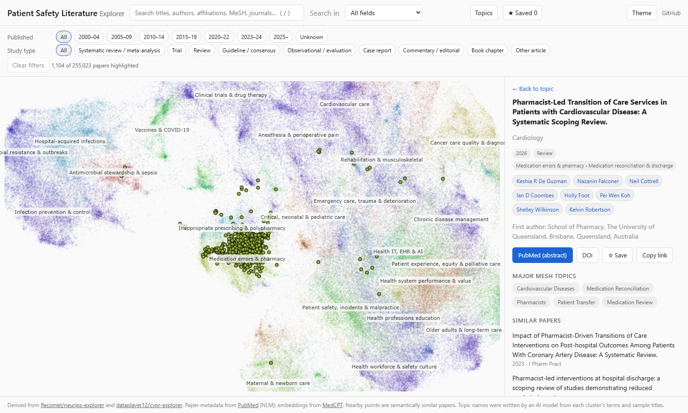
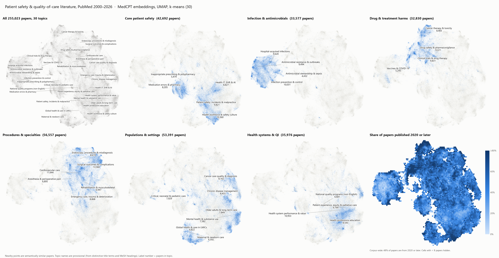

# Patient Safety Literature Explorer

An interactive 2D map of 255,023 PubMed papers (2000–2026) on patient safety, medical error,
adverse events and quality of care. Each point is a paper; nearby points are papers with similar
titles and abstracts. Papers are grouped into 30 topics and 200 subtopics.

**Live site: https://chenyangli4288.github.io/patient-safety-explorer/**



## Features

- Map of all papers, coloured by topic. Topic names are drawn on the map; subtopic names appear as you zoom in.
- Topic list: click a topic to zoom to it, see its subtopics and its newest papers.
- Filters by publication period and study type (systematic review / meta-analysis, trial, review,
  guideline, observational, case report, commentary, book chapter).
- Search over titles, journals, authors, first-author affiliation and major MeSH headings.
- Author search, with suggestions as you type.
- Paper panel: journal, year, authors, major MeSH headings, links to PubMed and the DOI, and the
  five most similar papers.
- Save papers in the browser and export them as CSV or Markdown.

Abstracts are not shown on the site because publishers hold their copyright. They were used to
compute the map, and each paper links to its PubMed page.

## Corpus

PubMed records with an abstract, published 2000 or later, matching any of:

- MeSH: *Medical Errors*, *Patient Safety*, *Iatrogenic Disease*, *Patient Harm*, *Quality Improvement*
- Title/abstract: medical / medication / diagnostic / surgical error; patient safety; never event,
  sentinel event, near miss, incident report, trigger tool; adverse event together with a hospital
  or health-care term; quality of care, quality improvement, health care quality

The exact query is in `count_corpus.py`. It returned 259,007 papers (retrieved 29–30 October 2026).
141 records without abstract text were dropped, and a cluster of 3,843 off-topic papers
(environmental "air/water quality" and imaging physics) was removed after the first map.

## Method

1. `fetch_corpus.py` downloads the records through NCBI E-utilities, one publication month at a
   time (PubMed returns at most 10,000 ids per search), including NCBI Bookshelf chapters such as
   AHRQ's *Advances in Patient Safety*.
2. `embed.py` embeds title + abstract with the
   [MedCPT article encoder](https://huggingface.co/ncbi/MedCPT-Article-Encoder) (768-d, CLS pooling).
3. `build_map.py` centres the embeddings, reduces them to 50 dimensions with PCA, clusters them with
   k-means (30 topics, 200 subtopics; each subtopic is assigned to the topic most of its papers
   belong to) and projects them to 2D with UMAP (cosine, 30 neighbours).
4. Topic and subtopic names in `labels.json` were written by an AI model (Claude) from each
   cluster's distinctive terms (class-based TF-IDF), over-represented MeSH headings and sample
   titles (`dump_for_labels.py`). They are descriptive, not authoritative.
5. `build_site.py` computes each paper's five nearest neighbours (cosine on the embeddings) and
   writes the site payload to `site/`.

`plot_map.py` draws a static overview (`docs/map_overview.png`).



## Running it

```
python -m venv .venv && .venv/Scripts/pip install torch transformers sentence-transformers umap-learn scikit-learn pandas pyarrow matplotlib adjustText
python fetch_corpus.py        # ~2 h, network only
python embed.py               # ~25 min on a 12 GB GPU
python build_map.py --drop drop_pmids.csv
python build_site.py
python -m http.server --directory site 8000
```

`data/` is not in the repository. The raw records include abstracts, and the whole pipeline can
be rerun from the scripts.

## Credits

The web page is adapted from [flecomet/neurips-explorer](https://github.com/flecomet/neurips-explorer),
which is derived from [dataplayer12/cvpr-explorer](https://github.com/dataplayer12/cvpr-explorer)
(MIT licence). Paper metadata comes from PubMed, courtesy of the U.S. National Library of Medicine.

## Licence

Code: MIT (see `LICENSE`). The bibliographic metadata in `site/` comes from PubMed/MEDLINE; see
NLM's [terms and conditions](https://www.nlm.nih.gov/databases/download/terms_and_conditions.html).
