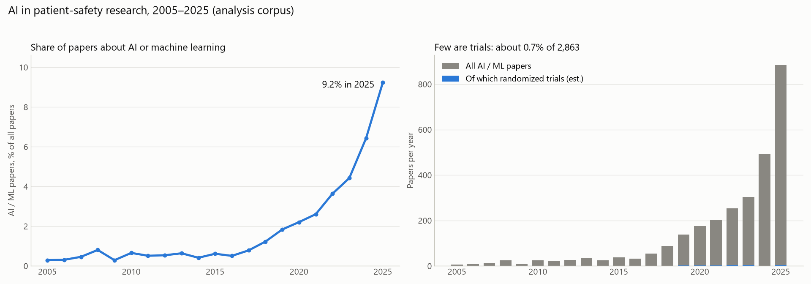
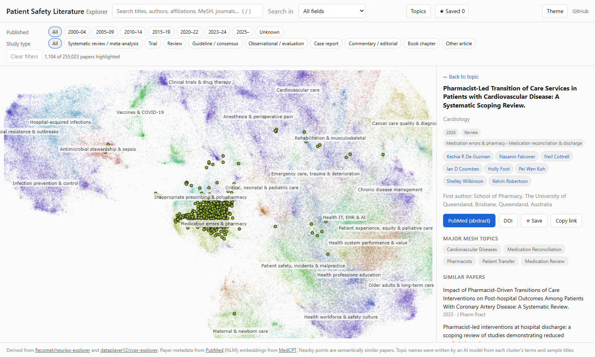
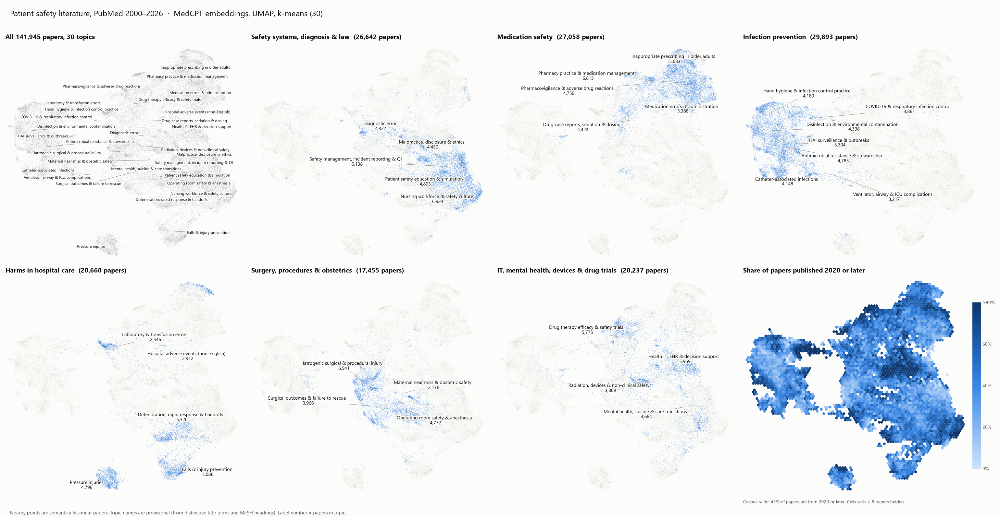

# Patient Safety Literature Explorer

An interactive 2D map of 141,945 PubMed papers (2000–2026) on patient safety: medical,
medication and diagnostic error, adverse events and harm from care, and how they are measured and prevented. Each point is a paper; nearby points are papers with similar
titles and abstracts. Papers are grouped into 30 topics and 200 subtopics.

**Live site: https://chenyangli4288.github.io/patient-safety-explorer/**





## Features

- Map of all papers, coloured by topic. Topic names are drawn on the map; subtopic names appear as you zoom in.
- Topic list: click a topic to zoom to it, see its subtopics and its newest papers.
- Filters by publication period and study type (systematic review / meta-analysis, trial, review,
  guideline, observational, case report, commentary, book chapter).
- Search over titles, journals, authors, first-author affiliation and major MeSH headings.
- Author search, with suggestions as you type.
- Paper panel: journal, year, authors, major MeSH headings, links to PubMed and the DOI, and the
  five most similar papers.
- Save papers in the browser and export them as CSV or Markdown.

Abstracts are not shown on the site because publishers hold their copyright. They were used to
compute the map, and each paper links to its PubMed page.

## Corpus

The map is built from the **v2 query** (`QUERY_TERM` in `count_corpus.py`, used by
`fetch_corpus.py`). It returned 142,049 papers (retrieved 23 November 2026). 58 records had no
abstract text, and 46 papers on the hand-made v1 drop list (`drop_pmids.csv`) were removed,
leaving 141,945.

The first map (October 2026) used the **v1 query**: 259,007 papers, of which 141 had no abstract
text and 3,843 off-topic papers (environmental "air/water quality", imaging physics) were removed
by hand, leaving 255,023.

v2 is aimed at patient-safety research specifically. It takes PubMed records with an abstract, published 2000 or
later, that match any of 22 components:

- MeSH: *Medical Errors* (not exploded), *Medication Errors*, *Medication Reconciliation*, *Near Miss*;
  *Diagnostic Errors* only together with a safety term; *Patient Safety*, *Patient Harm*;
  *Iatrogenic Disease* as a major topic; *Safety Management* in care settings, *Root Cause Analysis*,
  error disclosure; *Patient Handoff*, *Clinical Deterioration*, *Rapid Response Team*; pressure
  injuries and falls in care settings; prevention of health-care-associated infections (bench
  microbiology excluded); CPOE, decision support, e-prescribing, EHRs, smart pumps and barcoding
  together with an error, safety, harm or alert term.
- Title/abstract: medical, medication, diagnostic and surgical error; "patient safety" together with an
  error, harm, incident or culture term; never and sentinel events, incident reports, trigger tools,
  near misses; adverse drug events, medication safety, drug-related problems; specific error types
  (prescribing, dispensing, administration, wrong-patient, wrong-site, look-alike/sound-alike,
  retained surgical items); alert and alarm fatigue, alert overrides; safety culture and climate,
  second victims, RCA, FMEA; harm measurement and safety indicators; test-result follow-up and missed
  diagnostic opportunities; rapid response and failure to rescue; handoffs; malpractice claims.
- Quality improvement, but only when QI is the main subject and a safety or harm term is present.

Why v1 was replaced:

1. In v1 the adverse-event term had no parentheses of its own. PubMed reads AND/OR left to right, so
   every core term was effectively ANDed with "hospital / inpatient / health care".
2. `"Medical Errors"[MeSH]` explodes into False Positive/Negative Reactions and Observer Variation
   (test accuracy, inter-rater reliability). That is 48% of its hits and the source of the
   imaging-physics papers.
3. The quality-of-care text terms were about 4% patient-safety papers. They contributed 90% of the
   hand-removed cluster.

On 23 November 2026 v2 retrieves 142,053 papers, against 260,677 for v1. About 62,000 are in both,
80,000 are new and 198,000 are no longer retrieved. Only 46 of the 3,843 hand-removed papers match v2.

Validation (`validate_query.py`; labels and samples in `docs/query_validation/`, 95% intervals):

| | v1 | v2 |
|---|---|---|
| Recall, Bates DW + Adelman JS papers (417 safety papers; used for tuning) | 60% | 93% |
| Recall, hold-out Singh H / Gandhi TK / Schiff GD papers (267) | 51% | 82% (87% with the diagnostic-safety arm, added after reviewing the misses) |
| Precision, strict (random sample of 150, title + MeSH) | 23% [17–31%] | 47% [40–55%] |
| Precision, including borderline papers | 27% [21–35%] | 64% [56–71%] |

The labelling criteria are in `validate_query.py`. In rough numbers, v1 holds about 61,000
patient-safety papers and v2 about 67,000 (56,000–78,000). Of the papers v2 no longer retrieves,
about 2% in a sample of 60 were patient safety, mostly infection-control papers without the
*prevention and control* subheading.

### Off-topic subtopics

A few clusters of the v2 map are off-topic or mostly so. They are kept on the map, not dropped, and
their names in `labels.json` end in "(off-topic)":

- S79 accidents, occupational and traffic injury (603 papers)
- S89 telecom "handover", networks and food safety (500), which comes in through the handoff terms
- S157 biofilms and antimicrobial materials (739)
- S188 lab science, sequencing and assay validation (757)
- topic 15 "Drug therapy efficacy & safety trials", mainly its subtopics S10, S108 and S109 (drug
  efficacy and safety trials)
- S60 cardiac intervention safety

`QUERY_V1` in `fetch_corpus.py` reproduces the first map:
`python fetch_corpus.py --query v1 --out data/raw_v1`.

## Method

1. `fetch_corpus.py` downloads the records through NCBI E-utilities, one publication month at a
   time (PubMed returns at most 10,000 ids per search), including NCBI Bookshelf chapters such as
   AHRQ's *Advances in Patient Safety*. Papers dated only by year match every month, so the raw
   files hold duplicates (203,342 records for 142,049 PMIDs); `embed.py` keeps one per PMID.
2. `embed.py` embeds title + abstract with the
   [MedCPT article encoder](https://huggingface.co/ncbi/MedCPT-Article-Encoder) (768-d, CLS pooling).
3. `build_map.py` centres the embeddings, reduces them to 50 dimensions with PCA, clusters them with
   k-means (30 topics, 200 subtopics; each subtopic is assigned to the topic most of its papers
   belong to) and projects them to 2D with UMAP (cosine, 30 neighbours).
4. Topic and subtopic names in `labels.json` were written by an AI model (Claude) from each
   cluster's distinctive terms (class-based TF-IDF), over-represented MeSH headings and sample
   titles (`dump_for_labels.py`). They are descriptive, not authoritative. The v2 map has 30
   topics, from "Nursing workforce & safety culture" to "Maternal near miss & obstetric safety",
   and 200 subtopics (see `labels.json`).
5. `build_site.py` computes each paper's five nearest neighbours (cosine on the embeddings) and
   writes the site payload to `site/`.

`plot_map.py` draws a static overview (`docs/map_overview.png`). `plot_ai_trend.py` draws
`docs/ai_trend.png`: a paper counts as AI / ML if its title or abstract mentions machine or deep
learning, artificial intelligence, NLP, neural networks or (large) language models, or it has an
AI / machine-learning MeSH heading; trials are papers typed Randomized Controlled Trial.



## Running it

```
python -m venv .venv && .venv/Scripts/pip install torch --index-url https://download.pytorch.org/whl/cu126
.venv/Scripts/pip install transformers sentence-transformers umap-learn scikit-learn pandas pyarrow matplotlib adjustText
python fetch_corpus.py        # ~1 h for v2 (~142k papers), network only; writes data/raw/
python embed.py               # ~15 min for v2 on a 12 GB GPU
python build_map.py --drop drop_pmids.csv   # ~3 min
python dump_for_labels.py     # cluster summaries for naming topics in labels.json
python build_site.py
python plot_map.py && python plot_ai_trend.py   # figures, written to data/ (copy to docs/)
python -m http.server --directory site 8000
```

`data/` is not in the repository. The raw records include abstracts, and the whole pipeline can
be rerun from the scripts.

## Credits

The web page is adapted from [flecomet/neurips-explorer](https://github.com/flecomet/neurips-explorer),
which is derived from [dataplayer12/cvpr-explorer](https://github.com/dataplayer12/cvpr-explorer)
(MIT licence). Paper metadata comes from PubMed, courtesy of the U.S. National Library of Medicine.

## Licence

Code: MIT (see `LICENSE`). The bibliographic metadata in `site/` comes from PubMed/MEDLINE; see
NLM's [terms and conditions](https://www.nlm.nih.gov/databases/download/terms_and_conditions.html).
